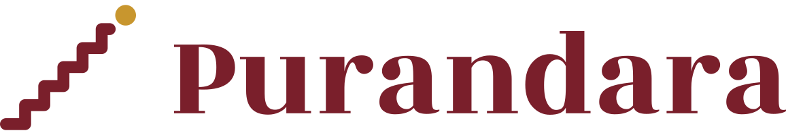

# Purandara branding



## The mark: Ārohaṇam

Five gold steps rise to a cream dot. The steps are an *ārohaṇam*, the
ascending scale every lesson begins with (sarali varisai is its first
practice); the dot is the upper Sa, where the climb arrives. It grows out of
the site's first favicon, a gold staircase on maroon, and says what the app is
for (practising, step by step) rather than showing an instrument.

| Variant | Where | Background | Steps | Dot |
|---|---|---|---|---|
| Icon, light | iOS home screen, Android launcher, favicon, apple-touch icon | maroon radial gradient | gold gradient | cream |
| Icon, dark | iOS dark mode | night radial gradient | gold gradient | cream |
| Icon, tinted | iOS tinted mode | black | grey `#C8C8C8` | white |
| Themed (monochrome) | Android 13+ themed icons | system | one colour | one colour |
| Mark alone | site masthead (`site/static/mark.svg`) | maroon bar | gold `#E8C163` | cream |
| Lockup | README, this guide (`tools/brand/lockup.svg`) | light | maroon | gold |
| Lockup on maroon | share image, dark surfaces (`tools/brand/lockup-on-maroon.svg`) | maroon | gold gradient | cream |

## Regenerating

Every icon and logo file is generated from one geometry by
[`tools/brand/build.py`](../tools/brand/build.py) (standard library plus
`rsvg-convert`: `brew install librsvg`):

```bash
python3 tools/brand/build.py
```

It writes the Android adaptive icon (`app/src/main/res/drawable/ic_launcher_*.xml`,
`mipmap-anydpi-v26/ic_launcher.xml`), the three iOS icons and their
`Contents.json`, `site/static/favicon.svg`, `apple-touch-icon.png`, `mark.svg`
and `images/og.png`, and the lockups and `icon-512.png` (store listings) in
`tools/brand/`. Don't edit those files by hand; change the script.

The wordmark and tagline are fixed vector outlines (`tools/brand/wordmark.svg`,
`tagline.svg`), converted once from the site's fonts with fontTools, so the
build needs no font. To change their text, convert again (fontTools and brotli
in a throwaway virtual environment) and keep the comment naming the font.

## Geometry

In a 1024 design space: five steps of 96, a 60-wide stroke with round caps
and joins, a 40 tail after the last riser, and a dot of radius 52 offset
(120, −70) from the top of the last riser. The bounding box (round caps and
dot included) is centred on the canvas.

- **iOS:** the mark's bounding box is 66% of the icon's width; the system
  applies the corner mask.
- **Android:** the mark fits the 66 dp safe circle of the 108 dp adaptive icon,
  so no launcher mask (circle, squircle, teardrop) clips it.
- **Clear space:** at least the dot's diameter on every side.
- **Minimum size:** 16 px for the icon; 24 px tall for the lockup.

## Colour

One palette across the Android theme (`ui/theme/Theme.kt`), the iOS accent
colour (`AccentColor.colorset`) and the site (`site/static/style.css`):

| Name | Hex | Use |
|---|---|---|
| Maroon | `#7A1F2B` | primary; icon background; site masthead and hero |
| Maroon light | `#8F2A37` | icon gradient highlight |
| Maroon deep | `#521523` | icon gradient edge; site deep surfaces |
| Gold (turmeric) | `#C8962E` | mark; Android secondary; site buttons and rules |
| Gold light | `#E8C163` | mark gradient highlight; mark on maroon |
| Gold soft | `#E9D59A` | text on maroon (7.0:1) |
| Cream | `#FFF8EE` | the dot; app light background |
| Night | `#1E0A0F` | dark icon background |

Contrast (WCAG): white on maroon 10.2:1, ink `#1F1724` on gold 6.5:1, gold soft
on maroon 7.0:1. Gold on maroon is 3.8:1: enough for graphics and large text,
not for body text. Gold on white is 2.7:1, so don't use gold for text or
thin lines on white (the site's gold focus ring on white is below 3:1 and
should change).

## Type

- **Rozha One** (display: the wordmark, headings on the site).
- **Mukta** (text: the site's body, the tagline).

Both are SIL OFL 1.1 and credited in [ATTRIBUTION.md](../ATTRIBUTION.md). The
apps use the platform's system fonts, which keeps Dynamic Type and font
scaling working.

## Don'ts

- Don't redraw, rotate, add steps to, or recolour the mark outside the
  variants above; don't separate the dot from the steps.
- Don't set the wordmark in another font, or stretch it.
- Don't put the light icon's gold on a light background; use the lockup
  (maroon steps, gold dot) there.
- Don't add drop shadows or outlines; the icon is flat apart from its two
  gentle gradients.
